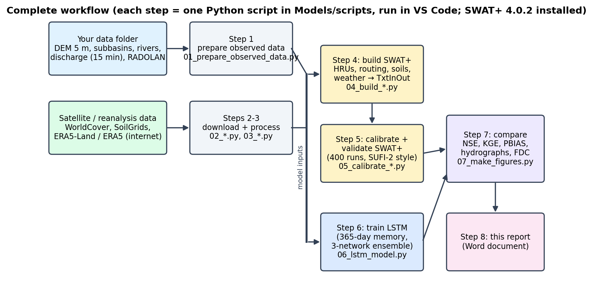
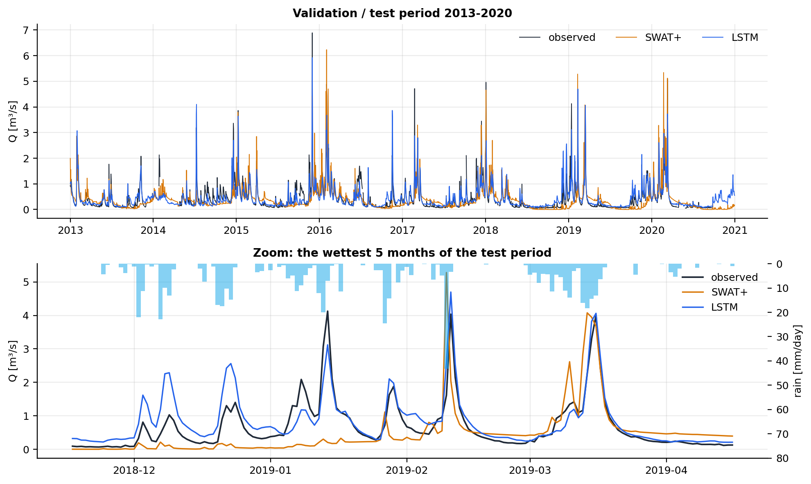

# SWAT+ and LSTM rainfall–runoff modelling of the Eifgenbach (gauge Markusmühle)

Daily discharge for a small German catchment (23.9 km², Bergisches Land) simulated in two ways and compared on the same periods:

- **SWAT+ 4.0.2**, a process-based, semi-distributed model built from open data and calibrated in plain Python in a SUFI-2 style (Latin hypercube sampling, two iterations, 400 runs).
- **An LSTM network** (PyTorch) that reads the last 365 days of rainfall and climate and predicts the next day's discharge.

This is coursework for the module *Water System Analysis* (M.Sc. Integrated Water Resources Management, TH Köln), done in 2026.

## Results

| Period | Model | NSE | KGE | PBIAS (%) | r |
|---|---|---|---|---|---|
| Calibration / training 2005–2012 | SWAT+ | 0.51 | 0.74 | −5.5 | 0.75 |
| Calibration / training 2005–2012 | LSTM | 0.79 | 0.77 | −0.4 | 0.90 |
| Validation / test 2013–2020 | SWAT+ | 0.37 | 0.65 | −13.4 | 0.68 |
| Validation / test 2013–2020 | LSTM | 0.80 | 0.86 | 0.3 | 0.89 |

Source: [`results/comparison_metrics.csv`](results/comparison_metrics.csv). SWAT+ default versus calibrated scores, together with the 95PPU p-factor and r-factor, are in [`results/swatplus_metrics.csv`](results/swatplus_metrics.csv).

**What this shows, and what it does not.** In this catchment the LSTM fits daily discharge better than the calibrated SWAT+ model in both periods, and SWAT+ loses more skill outside its calibration period. SWAT+ still gives a closed water balance and process states (evapotranspiration, percolation, lateral flow) that the LSTM does not. This is one small catchment with eight years of training data, so the comparison should not be generalised.

## Workflow

| Script | What it does | Runtime |
|---|---|---|
| `scripts/01_prepare_observed_data.py` | 15-min discharge and hourly RADOLAN rainfall to daily series, with a data-quality report | seconds |
| `scripts/02_download_satellite_data.py` | ESA WorldCover 2021, SoilGrids and ERA5-Land/ERA5 (via the Open-Meteo archive API) | 3–5 min |
| `scripts/03_process_satellite_inputs.py` | land-use shares, soil profiles, daily climate and FAO-56 reference ET | seconds |
| `scripts/04_build_swatplus_project.py` | HRUs, routing, soils and weather written into a SWAT+ project | ~35 s |
| `scripts/05_calibrate_validate_swatplus.py` | 250 + 150 Latin hypercube runs, best set by KGE, 95PPU band, parameter sensitivity | ~40 min |
| `scripts/06_lstm_model.py` | LSTM with a 365-day look-back, three random seeds, plus a rain-only experiment | ~50 min on CPU |
| `scripts/07_make_figures.py` | all figures and the SWAT+ versus LSTM comparison | seconds |

Shared paths and periods are in `scripts/_common.py`. Warm-up 2001–2004, calibration 2005–2012, validation 2013–2020.

## Data

| Data | Source | In this repository? |
|---|---|---|
| Discharge, gauge Markusmühle (15 min) | provided for the course | **No.** Not openly licensed |
| RADOLAN hourly rainfall (basin and 3 subbasins) | DWD, provided as basin series for the course | No |
| Land cover | ESA WorldCover 2021 (CC BY 4.0) | Downloaded by script 02 |
| Soil | ISRIC SoilGrids (CC BY 4.0) | Downloaded by script 02 |
| Climate | ERA5-Land / ERA5 through Open-Meteo | Downloaded by script 02 |

Without the discharge and rainfall files, scripts 01, 05 and 06 cannot be re-run. The code, figures and metrics are shared so that the method can be read and reused for another catchment.

## Requirements

Python 3.11 or newer and `pip install -r requirements.txt`. SWAT+ 4.0.2 must be installed separately ([swat.tamu.edu](https://swat.tamu.edu/software/plus/)); set `SWATPLUS_HOME` if it is not in your home folder.

## Figures

All figures are in [`figures/`](figures). Among them are the study area (fig01), dotty plots and sensitivity (fig09–10), the LSTM training curve (fig14), flow duration curves (fig17) and the seasonal cycle (fig18).

## Author

Rifah Muhaimina Rahman, M.Sc. student in Integrated Water Resources Management, TH Köln. Code released under the MIT License.
